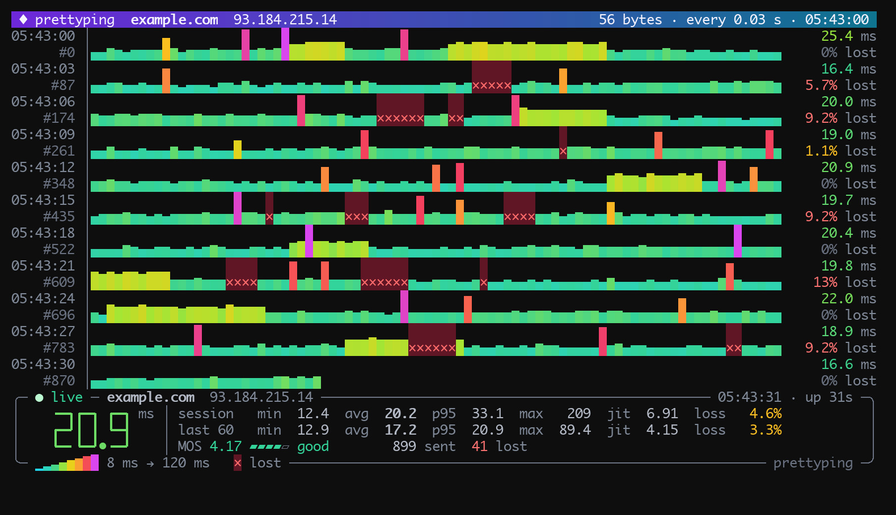
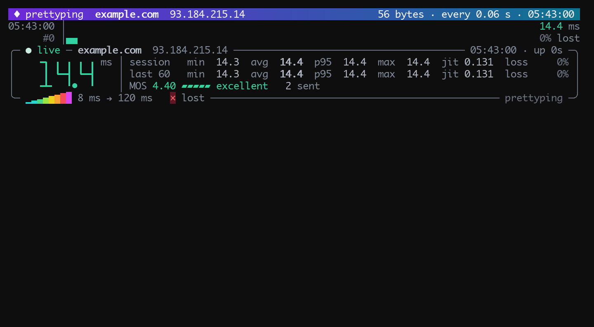
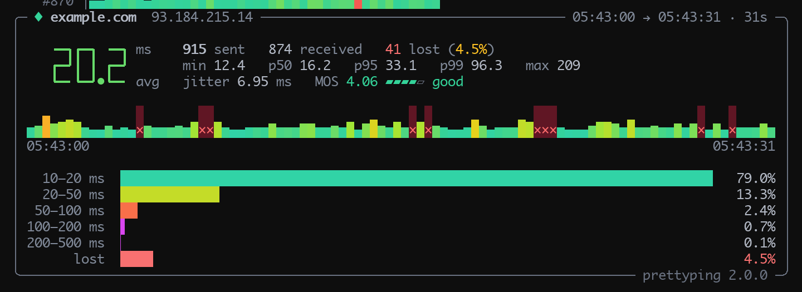

prettyping
==========

`prettyping` is a wrapper around the standard `ping` tool that makes its output
prettier, more colorful, more compact, and easier to read.

It runs your system's `ping` in the background and draws every reply as a
bar: the taller and warmer the bar, the slower the reply. Lost packets are red
crosses. Below the graph, a live panel shows the latest reply in big digits,
the statistics of the whole session and of the last minute, and whether
replies are still coming in. When ping stops, or you press Ctrl+C, the panel
turns into a summary of the session.

This is version 2, a fork of [denilsonsa/prettyping][upstream] with a
redesigned display. Like the original, it is a single `bash` and `awk` script
with no other dependencies, and it works with the `ping` of Linux (iputils),
macOS, the BSDs and busybox.

Reading the display
-------------------

**The graph.** Each row starts with the time it began and the sequence number
of its first packet, and ends with the row's average latency and loss. Bars
are two lines tall, which gives 16 heights, and their color runs from cyan
through green, yellow and orange to red and magenta. Lost packets are red
crosses; a reply that arrives after its packet was counted as lost turns its
cross back into a bar.

The scale is logarithmic. It is set from the first reply so that your usual
latency sits about a quarter of the way up: jitter shows as small steps, and
spikes up to about seven times slower than usual still fit. The legend at the
bottom of the panel shows the range. Use `--rttmin` and `--rttmax` to fix it
yourself.

**The panel.** The status says `● live` while replies come in, `waiting` when
they are late or some are lost, and `no reply` when they have stopped. The
statistics are the minimum, average, 95th percentile, maximum, jitter (the
average difference between consecutive replies) and loss, for the session and
for the last 60 packets (`--last`). MOS estimates how a voice call would sound
over the connection, from 1 (bad) to 4.4 (excellent), with a simplified ITU-T
E-model. Messages from ping, such as `No route to host`, are printed once
between rows, and their repeats are counted in the panel. The terminal title
shows the latest latency too, so you can watch it from another tab.

**The summary.** When ping stops, the panel is replaced by a summary of the
whole session: the counts, percentiles, jitter and MOS, the session squeezed
into one row of bars, and how the replies were spread over latency ranges.

The colors adapt to the terminal: 24-bit color where it is available, then
256 or 16 colors, and a palette for light backgrounds, chosen by asking the
terminal (`--theme`). Narrow or short terminals get a slimmer panel and
one-line rows. When the output is not a terminal (a pipe or a file), rows of
60 bars are printed with the statistics after each, and the summary at the
end.

What is new in version 2
------------------------

- Two-line bars with a smooth color gradient, and a time and sequence gutter.
- The live status panel, the summary when ping stops, and the terminal title.
- Light and dark palettes, chosen automatically.
- Late and duplicate replies are recognized and counted apart.
- Messages from ping are printed once instead of after every packet.
- prettyping exits with ping's own exit status.
- Support for busybox `ping` (`seq=`), iputils `ping -D` and `-O`, macOS
  `ping6` and `ping --apple-time`.
- Ctrl+Z and `fg` work, keys typed during a run are not left for the shell to
  run, and the terminal is restored even when prettyping is killed.

It also fixes these bugs of version 1:

- A duplicate reply was drawn and counted twice.
- A late reply drew an extra bar, then a second, wrong loss.
- On macOS, the second reply reset the minimum and maximum, and replies under
  1 ms showed as 0.
- With `--noterminal`, the average could be higher than the maximum, and the
  last row was never finished.
- When a `Request timeout` line skipped ahead, the packets in between were not
  counted as lost, and packets lost at the end of a `-c` run were never
  counted.
- `--rttmin 0.5` failed, and `--last abc` silently turned the statistics off.

Requirements
------------

* `bash` 3.2 or newer
* `awk`: [gawk][], [mawk][], [nawk][] (the BWK awk of macOS and the BSDs) or
  [busybox awk][]
* `ping`: from `iputils`, macOS, the BSDs or busybox, or any other version that
  prints essentially the same output, like [oping][]; [httping][] works too
* Optionally `stty` or `tput`, to find the size of the terminal

Installation
------------

1. Download the [`prettyping`](prettyping) script and save it anywhere.
2. Make it executable: `chmod +x prettyping`

That's all! No root permission is required. You can save and run it from any
directory. As long as your user can run `ping`, `bash` and `awk`, then
`prettyping` will work.

For people building a `prettyping` package, just install the `prettyping`
script into `/usr/bin/`, or whatever directory is appropriate. No other file
is necessary.

Usage
-----

    prettyping [prettyping parameters] <ping parameters> host

For example:

    prettyping 1.1.1.1
    prettyping -i 0.2 example.com           # five pings a second
    prettyping -c 100 192.168.1.1           # stop after 100 packets
    prettyping --compact --last 30 8.8.8.8
    prettyping --pingbin ping6 ::1
    prettyping --nocolor 1.1.1.1 > ping.log # plain text, for a file

prettyping parameters:

    --[no]color        Enable/disable color output. (default: enabled, unless
                         the NO_COLOR environment variable is set)
    --colors <n>       Color depth: 16, 256 or 24 (truecolor). (default: auto)
    --theme <t>        Colors for a dark or light background: dark, light or
                         auto, which asks the terminal. (default: auto)
    --[no]multicolor   Enable/disable the latency color gradient. Has no effect
                         if color is disabled. (default: enabled)
    --[no]unicode      Enable/disable unicode characters. (default: enabled)
    --[no]compact      Draw each row of bars one line tall instead of two.
                         (default: disabled)
    --[no]legend       Enable/disable the latency legend. (default: enabled)
    --[no]globalstats  Enable/disable the session statistics. (default: enabled)
    --[no]recentstats  Enable/disable the "last n" statistics. (default: enabled)
    --[no]summary      Enable/disable the summary printed when ping stops.
                         (default: enabled)
    --[no]title        Enable/disable showing the latency in the terminal
                         title. (default: enabled)
    --[no]terminal     Force the output designed to a terminal. (default: auto)
    --last <n>         Use the last "n" pings at the statistics line.
                         (default: 60)
    --columns <n>      Override auto-detection of terminal dimensions.
    --lines <n>        Override auto-detection of terminal dimensions.
    --rttmin <n>       Minimum RTT represented in the graph. (default: auto)
    --rttmax <n>       Maximum RTT represented in the graph. (default: auto)
    --awkbin <exec>    Override the awk interpreter. (default: awk)
    --pingbin <exec>   Override the ping tool. (default: ping)
    --version          Print the version and exit.

The ping parameters `-f` (flood), `-q` (quiet) and `-R` (record route) are not
allowed, `-a` (audible) is not implemented yet, and `-v` is ignored. All other
parameters are passed directly to ping.

Development
-----------

[`tests/fakeping.py`](tests/fakeping.py) is a fake ping that needs no network.
It replies with made-up but plausible latencies, or plays a script of exact
events (replies, losses, duplicates, late replies, messages), in the output
style of iputils, macOS, busybox, macOS `ping6` or httping:

    ./prettyping --pingbin tests/fakeping.py -i 0.1 --seed 7 example.com

[`tests/run_tests.py`](tests/run_tests.py) checks the counts and statistics with
every awk it finds, and the screen layout on a pseudo-terminal when [pyte][] is
installed (`pip install pyte`):

    tests/run_tests.py
    tests/run_tests.py --awk mawk --bash /bin/bash

Credits
-------

prettyping was written by Denilson Figueiredo de Sá, and is released under the
[MIT license](LICENSE). The original project lives at
[denilsonsa/prettyping][upstream], and its history, screenshots and videos at
<http://denilsonsa.github.io/prettyping/>.
[Donation - buy him a coffee](https://denilson.sa.nom.br/donate.html)

[upstream]: https://github.com/denilsonsa/prettyping
[gawk]: https://www.gnu.org/software/gawk/
[mawk]: https://invisible-island.net/mawk/
[nawk]: https://github.com/onetrueawk/awk
[busybox awk]: https://www.busybox.net/downloads/BusyBox.html#awk
[oping]: http://verplant.org/liboping/
[httping]: https://www.vanheusden.com/httping/
[pyte]: https://github.com/selectel/pyte
